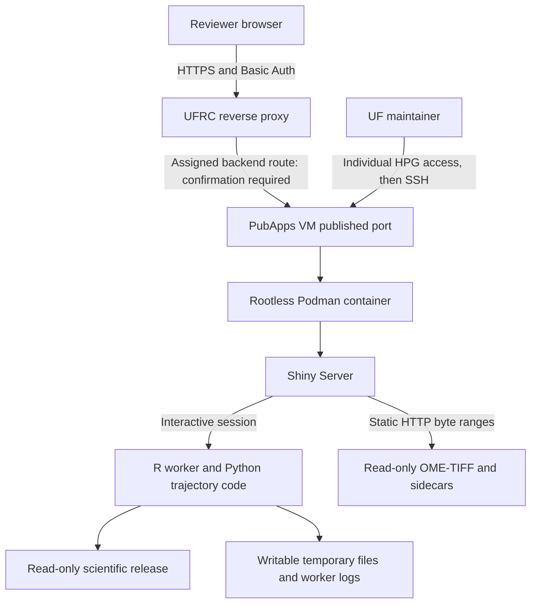

# Islet Explorer: maintainer walkthrough and UFRC deployment briefing

Prepared 2026-09-10 for a maintainer experienced with R, Python, Linux, and Git, with a refresher on containers. This is a teaching companion to [the production runbook](../deploy/README.md), not a replacement release procedure. The [file-by-file guide](repository_file_guide.md) provides the repository reference.

This walkthrough describes the inspected checkout, its retained release records, and UF's public documentation checked on this date. It does not attest that the requested UFRC endpoint is configured or approved. No deployment or scientific recomputation was performed for this walkthrough.

**1. The architectural model to keep in your head**

There are three related systems in this workspace:

| System | What it does | Where it belongs |
|---|---|---|
| Research preparation | Processes microscopy and cell tables, builds annotations, aggregates islets, computes features, and checks scientific results | Research workstation or appropriate HiPerGator compute environment |
| Release construction | Freezes code/dependencies, converts canonical data into the runtime layout, verifies parity, and records hashes/security evidence | Controlled build and staging environments |
| Reviewer service | Serves Shiny sessions and approved tissue images from one frozen release | UFRC PubApps VM behind the UFRC proxy |

The reviewer service still performs calculations. In particular, trajectory/PAGA can be refit for a selected islet cell-count range. “Immutable data” means those calculations do not overwrite the release. It does not mean every response is a precomputed static page.

The selected profile exposes **Plot, Trajectory, Viewer, and Spatial**. AI, Statistics, and Inflammation are disabled. It has no server-side upload endpoint, managed database service, Slurm submission, or configured production external AI/API integration. CSV/PNG exports are generated as session responses.

UF describes PubApps as a VM-based research application hosting environment with Podman as its container runtime. Its `/pubapps` storage is separate from HiPerGator storage and requires explicit transfer. [UFRC architecture](https://docs.rc.ufl.edu/services/web_hosting/).



The existing [SVG](pubapps_architecture.svg) and [PNG](pubapps_architecture.png) are the more detailed request diagrams. The public hostname, path, backend target, and operational log destination must be reconciled with UFRC's assignment.

**2. Walk the repository in deployment order**

```text
Islet-Explorer/
├── README.md                         project orientation
├── PUBAPPS_UFRC_HANDOFF.md            request, ownership, and acceptance record
├── UFIT_PubApps_Instance_Request.docx populated form plus supplied policy/standards
├── app/
│   ├── docs/logo.png                 actual application asset
│   └── shiny_app/
│       ├── app.R                     application entrypoint and session wiring
│       ├── R/                        shared helpers and UI/server modules
│       ├── python/                   runtime PAGA implementation
│       ├── www/                      browser-served assets
│       ├── docs/                     scientific method documentation
│       └── tests/                    application checks
├── deploy/                           container, service, release, and acceptance tooling
├── docs/                             operating, reviewer, and evidence documentation
├── scripts/                          data preparation, validation, and research utilities
├── data/                             local canonical/prepared scientific inputs
├── single_cell_analysis/             upstream single-cell research
├── islet_analysis/                   upstream aggregation/trajectory research
├── notebooks/                        scientific validation notebooks
├── external/Phenocycler_Analysis/     separately versioned upstream pipeline
├── archive/                          superseded code and historical notes
├── literature/                       local references
├── .github/workflows/                source and image CI
└── tmp/                              local staging, evidence, dependencies, and experiments
```

Read these first: `docs/ufrc_readiness.md`, `deploy/README.md`, `deploy/islet-explorer.container.in`, `deploy/shiny-server.conf`, `app/shiny_app/app.R`, and `app/shiny_app/R/01_runtime_data_backend.R`. They establish status, contract, process supervision, routing, session structure, and data access respectively.

The full working directory is much larger than the runtime release. The initial metadata survey found 5,214 per-islet CSVs under `data/cells/`, 15 donor CSVs, and 60 image-store entries: 15 TIFFs plus metadata and offset sidecars/aliases. It measured about 108.24 GiB in the local image tree and 1.81 GiB in `data/`, without following symlinks. The `tmp/` tree includes multiple staged releases and build evidence. These sizes are logical file sizes, not deduplicated physical storage accounting.

Git tracks 225 entries at the inspected revision: 224 files/symlinks and one submodule reference. Most scientific assets, installed environments, and temporary files are ignored. A Git clone therefore cannot reproduce the full data-bearing workspace by itself. `.gitignore` also does not remove anything already tracked or erase history.

The file guide accounts for every tracked entry. The local inventory additionally lists ignored files, installed dependencies, generated files, and symlinks. Git's internal object store is represented as repository metadata rather than explained object by object. File inventories describe paths and roles; they do not certify the contents or classification of research assets.

**3. Trace one Shiny session**

Shiny loads the `R/` support files and evaluates `app.R`. The live configuration is in `R/00_globals.R`; the entrypoint's old comment mentioning `global.R` is stale. There is no live `global.R` in this checkout.

`00_audit.R` provides fixed-field logging and shared validation helpers. `00_globals.R` loads packages and defines paths, feature flags, palettes, scientific constants, and shared UI helpers. `01_runtime_data_backend.R` defines the manifest and DuckDB interface. The other files define data loaders, helper functions, and modules.

At `app.R` startup, `load_shared_prepared_data()` loads a prepared object once per R worker. Each invocation of `server(input, output, session)` then creates session-specific reactives such as `selected_islet` and `forced_image`. The session wraps the shared data in the existing reactive interface without repeating the entire preparation pipeline.

For example, changing a Plot filter updates an input over the Shiny connection, invalidates relevant reactives in `mod_plot_server.R`, and produces a new plot or table. Clicking an islet updates shared **within-session** selection state, which can coordinate a trajectory selection, cell drilldown, and image viewer. The immutable source summaries are shared across sessions within the process; reviewer selections are not intended to be global across users.

| File or pair | What to understand |
|---|---|
| `app.R` | Top-level HTML/CSS/JavaScript, visible tabs, shared session state, module invocation, and common drilldown downloads |
| `mod_plot_ui.R` / `mod_plot_server.R` | Plot controls, filtering, distributions, exports, and selection events |
| `mod_trajectory_ui.R` / `mod_trajectory_server.R` | Composition trajectory, count-range selection, linked views, PAGA, and exports |
| `mod_viewer_ui.R` / `mod_viewer_server.R` | Image selection and local Avivator embedding |
| `mod_spatial_ui.R` / `mod_spatial_server.R` | Neighborhood summaries, donor tissue views, distance analyses, and exports |
| `mod_statistics_*`, `mod_inflammation_*`, `mod_ai_assistant_*` | Retained optional modules; their UI and server wiring are gated off in the reviewer profile |
| `paga_layout.R` / `python/paga_pseudotime.py` | R-to-Python bridge and graph/diffusion calculations for the selected population |
| `barlow_pseudotime.R` | Composition-based diffusion pseudotime support |
| `spatial_helpers.R`, `segmentation_helpers.R`, `drilldown_helpers.R` | Data queries, indexed geometry access, and per-islet cell loading/rendering |
| `viewer_helpers.R` | Controlled image/path selection and viewer configuration |
| `utils_safe_join.R`, `utils_stats.R` | Data-join and statistical helpers with consequences for scientific correctness |

A UI module describes controls and output locations; a server module defines reactivity and computation. Neither is a separate network service. The Python bridge runs within the application environment; it does not imply a separately deployed Python API.

Shiny's process model matters for capacity: shared caches are per worker, and synchronous work can delay other work assigned to that worker. Five sessions do not automatically mean five independent R processes. Avoid promising concurrency from a single-user timing test.

**4. Understand the two data layouts**

Development can read `data/islet_explorer.h5ad` and fall back to `data/master_results.xlsx`. Production requires a generated manifest and prepared summary files. A missing production release fails startup instead of silently selecting development data.

The release builder invokes the scientific preparation code and converts its output into a layout designed for runtime queries. It does not simply copy the local `data/` directory.

| Development/source input | Generated release artifact | Runtime reason |
|---|---|---|
| App H5AD, interpreted through preparation functions | `summary/core_area.parquet`, `targets.parquet`, `markers.parquet`, `islets.parquet`, `combined_pairs.parquet` | Small prepared summaries loaded once per worker |
| `cell_distance.csv` | `spatial/cell_distance.parquet` | Selective distance/composition queries |
| `signed_distance_kde.csv` | `spatial/signed_distance_kde.parquet` | Signed-distance analysis |
| `donors/*.csv` | `spatial/tissue/case_id=<id>/<id>.parquet` | Partitioned donor tissue lookup |
| `json/*.geojson` or `gson/*.geojson.gz` | `geometry/*.gpkg` | Spatially indexed segmentation reads |
| `cells/*.csv` | `cells/*.csv` | Small direct lookups per selected islet |
| Trajectory H5AD and selected lookup/rule/metadata CSVs | Same selected filenames | Scientific runtime inputs and provenance |
| Local TIFFs and sidecars | `images/` | Browser image streaming |

Parquet is the columnar storage format. DuckDB is the embedded query engine, connected to an in-memory database and scanning read-only files. There is no DuckDB service account, listening database port, or database server for UFRC to provision. GeoPackage uses a file database internally, but likewise creates no network database service.

The inspected backend defaults to two DuckDB threads and a 1 GB DuckDB memory setting. Those are distinct from the one-thread BLAS/OpenMP limits and the 14 GiB container memory limit. DuckDB can spill into the writable temporary area. Its memory setting is not a total R/Python process memory ceiling.

The retained `5809be4` data manifest reports:

| Artifact | Count |
|---|---:|
| Trajectory H5AD observations, per the readiness record | 5,214 |
| Core area rows | 5,382 |
| Composition summary rows | 5,382 |
| Target rows | 48,438 |
| Marker rows | 64,584 |
| Combined-pair definitions | 21 |
| Cell-distance rows | 2,649,654 |
| Signed-distance KDE rows | 348,930 |
| Donor-tissue rows across partitions | 2,649,654 |
| Geometry files | 15 |
| Per-islet cell CSV files | 5,214 |

These populations represent different scientific tables. Their row counts need not all equal the H5AD observation count. This is useful when IT asks about volume, and when a reviewer asks whether a migration dropped data.

There are two different verification questions. A **checksum** asks whether the bytes equal the frozen bytes. **Scientific parity** asks whether format conversion preserved the data and the application's interpretation: categories, row identity, numeric values, missingness, geometry, and query results. The project already caught a real conversion failure where blank `islet_name` strings became missing values. That rejected candidate is why “the Parquet files open successfully” is insufficient acceptance.

The generated data `manifest.json` binds schema, artifacts, source revision, and hashes. The outer release `MANIFEST.sha256` and `release.env` bind the assembled release and image/evidence identity. `.verified` is a generated verification stamp. It is not a signature from UFRC or the PI.

**5. Refresh the container concepts against the actual implementation**

| Concept | Meaning here | Maintainer implication |
|---|---|---|
| Container image | Packaged filesystem containing the application, R/Python runtimes, packages, and server | Build a new image to change code/dependencies |
| Container | Running instance of that image, with configured identity, mounts, limits, and networking | A correct image can still be started incorrectly |
| OCI | Portable image/archive format | Transfer a tested OCI archive into Podman without requiring a registry |
| Tag | Mutable name pointing to an image | Useful during building; insufficient release identity |
| Image ID | Content identity in the local image store | The default release reference after archive import |
| Registry digest | Content identity of a registry manifest | Alternative only with the approved registry route |
| Base image digest | Frozen starting image for the build | It identifies an input, not the completed app or its scan status |
| Layer | Part of an image filesystem | Deleting a secret in a later layer does not reliably remove it from earlier layers |
| Build context | Files available to `COPY`/`ADD` | The whitelist in `deploy/containerignore` is a critical boundary |
| Bind mount | Host path presented at a container path | Scientific data stay outside image layers and can be mounted read-only |
| Rootless | Podman runs under an ordinary host account | Host UID mapping and path permissions must still work |
| User namespace | Maps container identities to host identities | `keep-id` maps the UFRC service user to the image's `shiny` UID/GID |
| tmpfs | RAM-backed ephemeral filesystem | Bounded here for `/run` and Shiny ephemeral state |
| cgroups | Kernel resource accounting/limits used by the runtime | Verify the assigned host supports effective CPU/memory/PID limits |
| Quadlet | Podman container configuration from which systemd generates a service | Persistently supervise the application through the user service manager |

The production container uses the host kernel; it is not another VM with an independently patched kernel. UFRC's host maintenance and the project's image maintenance are separate responsibilities.

`Containerfile` is a multi-stage build. One stage rebuilds the pinned Shiny Server runtime and runs its checks. The final stage installs the scientific environment, copies the server and app, creates runtime mountpoints, and selects the unprivileged `shiny` account. It is based on digest-pinned Rocker/R 4.5.1. The production installer specifically enforces `destiny` 3.22.0 and DuckDB 1.5.2, and the Python environment is version-locked. The image records the actual resolved R package set.

Reusing the same base digest does not imply a byte-identical future rebuild: the build also performs package repository operations and an OS update. The retained OCI archive is the exact frozen executable artifact. Rebuilding it later creates a new candidate that needs its own recorded dependency set, scan, and scientific validation.

`EXPOSE 3838` in the build recipe is metadata; it does not publish a host port. `PublishPort` in the Quadlet makes the actual host mapping. Likewise, rely on the service's explicit health configuration: this project's OCI workflow requires a runtime healthcheck, and the current `run.sh` working change adds it to the manual smoke launcher.

The selected service drops Linux capabilities, forbids gaining new privileges, uses a read-only root filesystem, and caps resources at two CPUs, 14 GiB memory, and 2,048 PIDs. These controls reduce the writable and privileged surface. They do not establish that host egress is firewalled or that container isolation eliminates every possible vulnerability.

**6. Translate host paths into container paths**

The requested host layout is:

```text
/pubapps/<project>/islet-explorer/
├── incoming/                         OCI archive and transfer sidecars
├── releases/<release>/
│   ├── data/
│   │   ├── manifest.json
│   │   ├── summary/
│   │   ├── spatial/
│   │   ├── geometry/
│   │   ├── cells/
│   │   ├── images/
│   │   └── selected H5AD/CSV inputs
│   ├── attestations/                 security and dependency evidence
│   ├── release.env
│   ├── MANIFEST.sha256
│   └── .verified
└── runtime/
    ├── logs/
    ├── tmp/
    └── deployments/                  active.state and previous.state
```

| Host source | Container destination | Access |
|---|---|---|
| Selected release's `data/` | `/srv/islet-explorer/data` | Read-only |
| Same release's `data/images/` | `/srv/islet-explorer/app/shiny_app/www/local_images` | Read-only |
| `runtime/logs/` | `/var/log/shiny-server` | Read/write |
| `runtime/tmp/` | `/tmp/islet-explorer` | Read/write |
| tmpfs allocation | `/run` | Read/write, 16 MiB |
| tmpfs allocation | `/var/lib/shiny-server` | Read/write, 64 MiB |

The image tree appears at two container paths, but those are mounts of the same host release, not two additional stored TIFF copies. The application uses `/srv/islet-explorer/data`; Shiny Server's static routes need the second location.

Code lives in the image at `/srv/islet-explorer/app/shiny_app`. The container environment supplies paths explicitly. A host `/pubapps/...` path is not automatically visible inside the container.

`:ro` stops container writes through that mount. It does not stop an authorized host process from editing the source directory. This is why the builder uses independent copies for production, and activation repeats full hashes. A hardlinked “copy” could change when another link to the same inode is edited.

The host-mounted log and temporary directories do not acquire a per-directory size limit merely because `/run` has a tmpfs limit. Their retention, cleanup, quota, and disk-space monitoring need an operating arrangement. Confirm the separate local Podman storage location and quota with UFRC; image layers and imported images do not live in the scientific data mount.

**7. Understand startup and environment propagation**

The process chain is:

```text
user systemd -> generated Quadlet service -> rootless Podman
  -> container-entrypoint.sh -> Shiny Server -> r-worker.py -> R/Shiny
                                                       -> reticulate/Python
```

The entrypoint checks that the process is running as the expected `shiny` UID/GID, that required directories are readable, and that temporary/log paths are writable. In production it rejects AI credentials and any enabled optional feature/debug configuration outside the reviewer contract.

Shiny Server resets much of the worker environment. `r-worker.py` exists because setting variables in Podman alone did not ensure that the R worker received them. The entrypoint writes an allowlisted environment profile into the temporary mount; the wrapper checks its ownership and mode, reconstructs the environment, disables user R startup files, resolves R through `PATH`, and executes R without a shell.

This distinction is operationally useful: a correct value in `podman inspect` does not prove R is using it. Check the worker's behavior and the deployment verifier. `RETICULATE_PYTHON` selects `/opt/islet-explorer-py/bin/python`; installing a module into the VM's system Python will not repair a missing package in that image environment.

The `Renviron.pubapps.example` is documentation of nonsecret settings. The Quadlet already supplies them. The local `.Renviron` is neither a production requirement nor a file to copy to the service. Production disables user `.Rprofile`/`.Renviron` loading through the wrapper.

**8. Trace the network routes with UFRC**

The requested public endpoint is `https://islet-explorer.rc.ufl.edu/islet-explorer/`. The hostname, backend address, and path are still request values in the inspected records. UFRC's deployment checklist distinguishes Public Open, Public Restricted, and Internal access. The project's selected access mode is Public Restricted. [UFRC deployment guidance](https://docs.rc.ufl.edu/services/web_hosting/deployment/).

The planned connection crosses separate address spaces:

1. The reviewer connects to the HTTPS hostname, normally on port 443.
2. UFRC's reverse proxy terminates TLS and authenticates the request.
3. The proxy forwards permitted traffic to its assigned backend target.
4. Podman forwards the VM's published port to port 3838 in the container.
5. Shiny Server either serves a static image response or forwards an application request to R/httpuv.

Inside the container, Shiny Server listens on `0.0.0.0:3838`. On the VM, the project currently requests `127.0.0.1:3838`. These are compatible because the container has its own network namespace. But **a proxy on another machine cannot directly connect to the VM's loopback address**. UFRC must confirm a local forwarding arrangement or assign a reachable private target with appropriate network controls. The Quadlet, activation script, and verifier currently assume loopback; a different assignment requires a coordinated configuration change and repeat validation.

Agree whether the proxy preserves `/islet-explorer/` or rewrites it. The supplied Shiny Server configuration expects the prefix. Incorrect rewriting can leave the entry page working while assets, downloads, or WebSockets fail. Also confirm forwarded host/protocol handling, timeout behavior, and whether the backend leg requires TLS under the assigned topology.

There are three traffic classes to test:

| Traffic | Example | Required behavior |
|---|---|---|
| Ordinary HTTP | HTML, CSS, JavaScript, PNG, CSV response | Correct content and authentication, sensible routing/MIME types |
| WebSocket | Long-lived Shiny interactive connection | Upgrade and sustained bidirectional traffic through the proxy |
| HTTP Range | `Range: bytes=0-15` against an approved TIFF | HTTP 206, correct Content-Range, exactly the requested 16 bytes |

The static TIFF routes are explicit `site_dir` locations for `local_images/`, `images/`, and legacy `img_data/`. Their directory listings are disabled. They bypass the R/httpuv static handler because that route returned a whole-file HTTP 200 in project testing. Protect all aliases at the proxy, even aliases the current viewer does not normally choose.

The viewer streams selected TIFF regions and resolution levels; it does not need every multi-gigabyte image loaded into R memory. Client browser/WebGL capability and network behavior matter alongside VM resources. HTTP byte-range success also says nothing about whether the correct scientific channel or spatial registration is displayed; browser/scientific acceptance is a separate check.

**9. Explain authentication, authorization, and classification precisely**

“Public Restricted” is the endpoint access mode. “Sensitive” is the selected data classification. “Restricted data” is a different classification term. A public internet endpoint can still require authentication for every request.

UF's classification guidance distinguishes open data, sensitive information such as unpublished research, and restricted information subject to legal or contractual protection. The exact released files and their permitted disclosures need the authorized data-owner/agreement review; labels such as “de-identified” are not enough by themselves. [UF information-security guide](https://it.ufl.edu/security/security-guidance/information-security-training/employee-guide-to-information-security/).

The repository's selected reviewer method is a shared, neutral Basic Auth credential at the proxy. Basic Auth encodes the credential; TLS provides confidentiality in transit. Authentication proves possession of that credential. It cannot identify which individual reviewer used it or selectively revoke one reviewer while retaining the same shared password for everyone else.

The reviewer credential is distinct from the maintainer's individual HiPerGator/SSH access. UFRC documents maintainer access from HiPerGator using public keys registered on the instance/service account. Both named maintainers should prove their own access; private keys stay with their owners. [UFRC SSH access](https://docs.rc.ufl.edu/services/web_hosting/ssh_access/).

Whole-site authentication must protect HTML, viewer code, downloads, WebSocket upgrades, TIFFs, XML/JSON sidecars, and every image alias. Hiding a button or protecting only the landing page does not protect its underlying URLs. Direct access to the nonweb scientific data tree must also be denied.

The browser `www/` boundary deserves attention: files intentionally served there are retrievable by an authenticated reviewer who knows their URL, even if the UI offers no download button. TIFF Range access should be treated as disclosure of the underlying image to authorized reviewers. Do not promise that streaming prevents a recipient from reconstructing or downloading the image.

The viewer's authored wrapper validates a same-origin local image URL before importing the vendor bundle, and its Content Security Policy limits browser resource origins. These controls address the vendor's default external demo behavior and URL input surface. A disabled AI tab and same-origin viewer controls do not, by themselves, establish a VM-wide outbound firewall policy.

Rotation after a review round, revocation at review end, confidential credential delivery, and the applicable access review are operating responsibilities in the handoff. Whether quarterly review is required for this Sensitive deployment remains an explicit UFRC applicability question. Do not invent additional approval gates from project recommendations.

**10. Walk the release lifecycle**

Use the exact commands in [deploy/README.md](../deploy/README.md) when executing this process. The sequence below explains what each step proves and where it runs.

| Stage | Location | Main files | Result and limits |
|---|---|---|---|
| Choose source | Development/build checkout | Git, source CI | Clean revision; includes the selected runtime code |
| Build image | Build host or controlled CI | `build-image.sh`, `Containerfile`, dependency inputs | Executable image with source labels and recorded package versions |
| Scan image | Same image store/build context | `scan-image.sh`, Syft, Grype | SBOM, vulnerability results, image-bound evidence; project gate rejects High/Critical findings |
| Export image | Build environment | `export-image.sh` | OCI archive, metadata, transfer checksums from the immutable image ID |
| Build data | Authorized data-build host | `build_release_data.R` | New directory with converted data, copies of selected assets, and schema/source/hash manifest |
| Verify science | Data-build environment | `verify_release_data.R`, `verify_release_parity.R`, `inventory_release_data.py` | Byte integrity, source-to-release parity, and sanitized asset/schema evidence |
| Transfer | Build/data staging through HPG to VM | `rsync`, archive sidecars | Scientific bundle, image archive, evidence, and required deployment tooling |
| Import and assemble | PubApps VM | `load-image.sh`, `generate-release-manifest.sh`, `verify-release.sh` | Identity-checked image and fully checksummed release directory |
| Activate | PubApps service account | `activate-release.sh`, Quadlet template | Verified candidate selected and started; local health/configuration checked |
| Accept externally | Clean non-UF client plus agreed operators | External verifier, browser tests, manual checks | Actual proxy/auth/interactive/image behavior, plus operational and owner acceptance |

The image's OCI revision label, generated data manifest revision, and `release.env` revision must match. Changing the code while keeping old data release metadata can fail this invariant even when a human expects the data to be compatible. Preserve the chosen release pair rather than editing metadata to force a match.

Full verification intentionally reads the large TIFF collection. The release generator hashes the content, explicit verification hashes it again, and activation rehashes immediately before replacing the service. Ordinary restarts use the smaller startup validation path rather than repeating the full image scan.

Activation performs identity, permission, rootless mapping, schema, hash, and data checks before replacement. It writes the rendered `.container` file, reloads user systemd, and restarts the service. It records active/previous state only after success. A failed candidate triggers restoration and verification of the previous unit; first-activation failure instead removes the failed candidate service.

This is a supervised service replacement with recovery. It does not provide session-preserving zero-downtime deployment. A restart can disconnect reviewers and lose their transient selections or in-progress downloads. Schedule changes accordingly.

Keep at least the active and previous matching image/data pairs and their evidence. Rolling back only code while retaining incompatible data defeats the release model. A rollback is also not a backup: loss of the VM/storage could remove both copies if they share the same failure domain.

**11. Supervision, recovery, and capacity**

UFRC's systemd documentation explicitly supports user-mode services and Quadlet files under `~/.config/containers/systemd/`. The service manager also needs the appropriate linger/startup setup. [UFRC systemd guidance](https://docs.rc.ufl.edu/services/web_hosting/systemd/).

The supplied Quadlet uses `WantedBy=default.target`. Its generated `.service` is managed by the generator; this project's activation procedure does not run `systemctl enable` on that generated unit. The source of truth is the `.container` file rendered from the release.

The healthcheck requests the local app page every 30 seconds, with a 180-second initial grace period, a 10-second timeout, and five retries. The unit is configured to kill an unhealthy container and restart on failure. Successful page health does not prove that PAGA computes, the image canvas renders, or a remote reviewer can authenticate.

UF's Shiny-specific page still contains a warning that startup after reboot may require operator intervention, while the systemd guidance describes automatic startup. Resolve this through the actual assigned host configuration and a controlled reboot test; do not infer it from either a template or successful logout alone. [UFRC Shiny guidance](https://docs.rc.ufl.edu/services/web_hosting/shiny/).

The requested initial VM is two vCPU and 16 GiB RAM, with the container limited to 14 GiB to leave host headroom. The recorded expectation is up to five concurrent reviewer sessions. Exercise simultaneous trajectory computation, spatial views, image navigation, and exports; observe CPU, memory, responsiveness, temporary usage, and disconnects. Agree useful response-time targets with the project rather than treating invented numbers as UF policy.

The public architecture currently lists a base allocation with two virtual CPUs, 16 GB memory, and 1 TB public-side storage, with local container storage separate. Confirm the assigned capacity and current quote before making a fiscal commitment. [UFRC allocation overview](https://docs.rc.ufl.edu/services/web_hosting/).

The retained data-release inventory reports about 117.1 billion bytes, roughly 109.05 GiB, including images. Two complete retained copies are roughly 218.1 GiB before OCI archives, logs, build staging, or transfer space. Base storage has room for that plan, but allocating space is different from configuring backups and quotas.

A high-availability proxy does not make the single backend VM highly available. Ask who monitors backend health, who receives alerts, who restores it, and what recovery time is acceptable. For this non-mutating scientific service, recovery can focus on restoring exact artifacts and configuration rather than replaying user database transactions.

**12. Read the assurance evidence without overstating it**

| Evidence | Question it answers | What it cannot establish alone |
|---|---|---|
| R parsing/lint | Is the source syntactically valid and compliant with selected checks? | Correct science or complete security |
| Unit/contract tests | Do specific calculations and deployment contracts behave as asserted? | Actual UFRC VM/proxy behavior |
| Scientific parity | Did the transformed release preserve the measured source semantics? | Permission to disclose those data |
| SAST | Does a configured static rule set flag source patterns? | Absence of every runtime vulnerability |
| SBOM | What components did the inventory tool identify? | Complete source provenance or that every component is safe |
| Vulnerability scan | What known findings match this artifact with this scanner/database? | Future safety, complete detection, or UF acceptance |
| Browser/axe checks | Do tested interactions and automated accessibility rules pass? | Complete manual accessibility or every client/network combination |
| External acceptance | Does the assigned HTTPS boundary protect and carry the tested traffic? | Whole scientific validation or institutional sign-off |
| UFRC/owner acceptance | Have the responsible parties accepted the defined deployment and disclosure? | A substitute for ongoing maintenance |

UF's development standards require input validation, linting, appropriate single-event logging, static analysis, SBOM maintenance, and vulnerability review. The supplied DOCX also contains the policy/project-plan requirements and ongoing network-scan obligations. The [readiness index](ufrc_readiness.md) maps those requirements to evidence and outstanding acceptance. [UFRC development standards](https://docs.rc.ufl.edu/services/web_hosting/standards/).

The project image gate requires no High or Critical Grype findings. UFRC's pre-production review and UFIT's continuing network scans are distinct controls. A scanner report needs the exact image identity, tool version, vulnerability database identity/date where available, report, and any documented corrections.

Two repository-specific supply-chain details are worth being able to explain:

- The old base runtime produced serious findings, so `harden-base.sh` rebuilds a checksum-locked Shiny Server runtime. `BASE_HARDENING.md` explains the rationale and validation. A bare base-image scan is not the final application scan.
- `correct-syft-vim-cpe.py` addresses one tightly scoped identity collision: the CRAN R package VIM was associated with the Vim text editor's CPE. Original evidence and the bounded correction are retained. This is not a blanket exclusion of findings containing “vim.”

The checked-in Avivator bundle has hashes and partial component detection but lacks a verified complete upstream revision/lockfile. The supplemental Retire.js result covers recognized signatures; it does not establish a complete transitive JavaScript inventory. Keep this limitation explicit in assessment discussions. See [vendor provenance](../app/shiny_app/www/avivator/VENDOR_PROVENANCE.md) and [browser SAST scope](../deploy/BROWSER_SAST.md).

The current CI workflows are evidence/build automation. The image workflow exports an artifact after its gate; it does not deploy the PubApps VM. Scientific parity with real controlled research data is also a separate recorded step from synthetic CI fixtures.

**13. Logging, monitoring, and incident ownership**

There are several streams, with different producers and custodians:

| Stream | Main source | Expected place to inspect |
|---|---|---|
| Application events | `00_audit.R` and module callers | Shiny worker logs in the dedicated host mount |
| Native R/package output | R worker and dependencies | Worker logs; content still needs exact-runtime review |
| Server/container lifecycle | Shiny Server, entrypoint, Podman | Container logs and effective server log destination |
| Service management | User systemd | `journalctl --user -u islet-explorer.service` |
| Proxy/auth/TLS | UFRC proxy | UFRC-controlled access/security/error logging |
| SSH/host administration | VM and access infrastructure | UFRC administrative/security records |
| Build/deployment evidence | CI and release scripts | Restricted durable release record |

The authored R logger emits allowlisted JSON event fields rather than raw selected donor values or exception text. This improves minimization, but dependencies and the proxy can still produce their own output. A framework log and a proxy access log need separate review.

Confirm the actual Podman log driver and whether `podman logs` and the journal overlap. Confirm that UFRC's collector receives the intended streams, where access is controlled, what retention applies, and who owns rotation/cleanup. Successful-session worker files are not retained indefinitely by Shiny Server, so collection timing matters.

Proxy URLs can contain image identifiers or viewer query parameters. Credentials, Authorization headers, cookies, session tokens, scientific rows, and full viewer query strings should not enter operational records. Security metadata such as IP/user agent may have a separate approved purpose and retention; shared authentication still provides no individual reviewer attribution. Use [the detailed log inventory](pubapps_log_inventory.md) to settle fields and custody.

Monitoring should distinguish four outcomes: process is alive, local app is healthy, external route works, and representative scientific interaction works. A lone HTTP 200 monitor addresses only part of that chain. Assign alert recipients and after-hours expectations rather than assuming IT watches application-level scientific failures.

For a suspected exposure, use the approved UF incident channel, coordinate containment with UFRC, preserve relevant evidence under the appropriate access controls, and follow the responsible team's clearance before reopening. [UF incident reporting](https://it.ufl.edu/security/report-an-incident/).

**14. The current state to communicate accurately**

The local [readiness record](ufrc_readiness.md), updated 2026-09-16, documents
these facts. Read-only UF Outlook searches found the latest assessment email;
no signed disposition or assigned host configuration has been established.
Examples and scientific counts earlier in this walkthrough describe the frozen
15-image release. The separate 21-image candidate is tracked in the
[expansion status](cohort_expansion_status.md).

| Item | Recorded state |
|---|---|
| Support/configuration references | UFRC `83810`; `SYSCONFIG-8173` |
| Individual assessment | `IRM-456246`; assigned ISM requested a brief Teams meeting on 2026-09-16; scheduling and review completion unconfirmed |
| Allocation | Trial `RC83797`, group `maigan`, 2026-08-31 through 2026-11-30 |
| Provisioning | Owner reported a VM; local assessment review and assigned host/account/SSH/proxy details remain pending |
| Frozen candidate | Source `5809be4`; image/security, full hashes, and 22 real-data parity checks recorded as passing |
| Current checkout | `000e970`, whose committed change from `5809be4` is the readiness documentation |
| Working changes | Offline cohort preparation, donor provenance/import validation, explicit release image counts and rollback support, hosted-runner package-source repair, and migration documentation |
| Expanded sources | 6090 verified against its raw planes; distinct 6539 reconstructed and pixel-validated; use the corrected six-image inventory |
| Expanded science | All six additions completed offline preparation: 943,068 cell objects and 2,989 independently checked islet-core counts. Original phenotype method remains unrecovered; biological review and joint analysis are pending |
| Browser evidence | Native production-profile checks recorded; not final external proxy acceptance |
| Remaining institutional/operational work | Assigned configuration, data/disclosure approval, genuine PI acknowledgment, deployed acceptance, log collection, and go-live approval |

Do not describe the current dirty working tree as the already tested frozen release. The teaching documents created with this walkthrough also make the development checkout differ from the candidate. Use a clean checkout of the intended release when building; preserve the retained candidate's identity if deploying those existing artifacts.

UF's public assessment guidance allows many projects to use the instance form attached to the infrastructure assessment, with individual assessment when UFRC requires it. This project already has an individual record; continue that record and the existing ticket. A started assessment or allocated VM is not a production acceptance record. [UFRC assessment guidance](https://docs.rc.ufl.edu/services/web_hosting/risk_assessment/).

**15. Responsibility boundaries for the setup meeting**

Treat this as a proposed working division to confirm, especially the operational rows. The PI/data owner must make disclosure and attestation decisions; technical tests cannot make those decisions on their behalf.

| Area | Project maintainer / PI contribution | UFRC / institutional contribution to confirm |
|---|---|---|
| Scientific scope | Exact assets, fields, outputs, cohort, methods, expected reviewers | Assessment/privacy/agreement routing where required |
| VM allocation | Group, contacts, load estimate, continuation funding | VM identity, assigned resources, host maintenance scope |
| Administrative access | Two named maintainers and individual public keys | Service account, permitted SSH route, account setup |
| Runtime | Image, release, Quadlet, paths, dependencies, app maintenance | Podman/version support, UID mappings, user systemd/linger, host controls |
| Network | Required prefix, WebSocket, Range, no production external API need | DNS, TLS, proxy target, network ACLs, header/timeout/auth configuration |
| Authentication | Approved reviewer model, rotation/revocation ownership | Proxy configuration and acceptable credential delivery/update process |
| Storage | Release pair, manifests, transfer plan, retention needs | `/pubapps` and local image quotas, permissions/ACLs, backup/snapshot service details |
| Security | Exact-candidate CI/SBOM/scans, documented limitations, remediation | Assessment disposition, pre-production acceptance, ongoing scan process |
| Logs | Application format, minimization, worker mount, release evidence | Collector, proxy/security fields, access, retention, alerts |
| Accessibility | Four-tab/browser/manual review and remediation | Applicable institutional review/acceptance expectations |
| Recovery | Release restore/rollback procedure and demonstration | Host recovery, maintenance notice, escalation contact |
| Go-live/end-of-life | PI/data-owner approval, reviewer communication, end date | Endpoint activation/restriction/removal process |

The populated request form asks for the purpose, audience, data categories, component/data-flow diagram, responsible people, and policy acknowledgment. Use the supplied DOCX together with the handoff; the acknowledgment must come from the actual responsible person. [UFRC instance form guidance](https://docs.rc.ufl.edu/services/web_hosting/instance_request/).

**16. A concise technical briefing you can give UFRC**

> We are deploying Islet Explorer for confidential journal review under the existing request and assessment. The selected profile has four Shiny tabs and serves a fixed scientific release and 15 donor OME-TIFFs. The application is packaged as an immutable OCI image for rootless Podman, supervised by a user Quadlet service. Scientific inputs are read-only; only temporary files and operational logs are writable. DuckDB is embedded and reads local Parquet, so no network database service is required. There are no Slurm submissions, server uploads, or configured production external AI/API calls. We need whole-site Basic Auth at the HTTPS proxy, persistent Shiny WebSocket support, and correct HTTP byte-range delivery for TIFFs. Our current service requests VM loopback port 3838; we need your confirmed reachable proxy target, assigned host/account/storage details, log-collection arrangement, and production acceptance process. We have retained candidate-specific build, scan, data integrity, and scientific parity evidence.

For the 2026-09-16 assessment meeting, add that the retained release above has
15 images and the separate expansion targets 21 (20 nPOD, one HPAP). The new
candidate requires completed scientific analysis and its own runtime evidence;
its current images plus the retained frozen bundle require at least 260.95 GiB
before new tables, staging, logs and container storage. The offline GPU workflow
does not add a GPU service to PubApps. Use the current handoff's inventory and
open assessment items when discussing the candidate.

Do not state “the service is approved,” “all dependencies are fully inventoried,” or “reviewers cannot download the source images.” The inspected records do not establish those claims.

Take these concrete questions to the existing ticket or meeting; they are a preparation checklist, not messages sent by this walkthrough:

1. What are the assigned VM, service account, SSH route, and actual provisioning/assessment status?
2. What exact hostname, public prefix, backend address, and port will the proxy use? Is there a local forwarding component permitting loopback, or must the service use a private interface?
3. Is the app prefix preserved? What are the WebSocket timeout, upgrade/header, byte-range, buffering, and backend-transport settings?
4. Does whole-site authentication cover every image alias, sidecar, static asset, download, and WebSocket path? Who applies/rotates/revokes credentials, and is shared authentication acceptable for this audience?
5. What Podman version, rootless UID/GID mappings, user-systemd/linger configuration, and cgroup support are present?
6. What are the `/pubapps` and local container paths, quotas, effective permissions, and staging allowances? What backups/snapshots actually exist, and who restores them?
7. Which log streams does UFRC collect, with what fields, access, rotation, retention, and alerting? Is Authorization consumed at the proxy rather than unnecessarily passed downstream?
8. What exact evidence closes the individual assessment and pre-production review? Is quarterly access review applicable here, and what recurring scan/remediation process applies?
9. What maintenance/reboot notice, incident escalation, and service recovery responsibilities are agreed? Can both maintainers demonstrate restart/rollback on staging?
10. How will the trial continue beyond 2026-11-30 if review lasts longer, and what is the eventual access/retention/decommissioning plan?

**17. Use diagnostics to identify the failing layer**

These commands are reference examples to run in the indicated environment. They were not executed against the PubApps VM for this walkthrough.

On the build checkout, identify source and local modifications:

```bash
git rev-parse HEAD
git status --short
git diff -- deploy/run.sh
```

On the assigned VM as the service account, inspect the runtime and supervisor:

```bash
id
podman version
podman info
loginctl show-user "$USER" -p Linger
systemctl --user status islet-explorer.service --no-pager
systemctl --user cat islet-explorer.service
podman ps --all
podman port islet-explorer
podman stats --no-stream islet-explorer
ss -ltn
```

Inspect bounded log windows locally and sanitize evidence before sharing:

```bash
journalctl --user -u islet-explorer.service --since '30 minutes ago' --no-pager
podman logs --tail 100 islet-explorer
```

Use the project's local verifier for the actual container contract:

```bash
deploy/verify-deployment.sh \
  --url http://127.0.0.1:3838/islet-explorer/ \
  --container islet-explorer \
  --range-path 'local_images/<approved-image>.ome.tiff'
```

Use [EXTERNAL_ACCEPTANCE.md](../deploy/EXTERNAL_ACCEPTANCE.md) for credential-file creation and the external verifier. It requires a private regular file with mode 0600, validates HTTPS, refuses redirects, and verifies the expected first 16 TIFF bytes. It avoids writing credentials or scientific bodies to evidence. The synthetic unauthenticated download probe establishes proxy protection, while actual authenticated scientific downloads are exercised through browser acceptance.

| Symptom | Likely layer / next discriminating observation |
|---|---|
| `Permission denied (publickey)` | Check the HPG-to-VM route, service user, selected key, and authorized-key setup |
| User systemd bus unavailable | Check service-account login context and user manager configuration with UFRC |
| Container exits before serving | Inspect fixed entrypoint errors: UID mapping, unreadable mounts, unwritable temp/logs, rejected feature flags |
| No R startup or missing data path | Check worker environment-profile handling, image revision, and mounted release layout |
| Local app works; external 502/504 | Proxy-to-backend reachability, target port/address, timeout, or path mapping |
| Page loads; interactions disconnect | WebSocket upgrade/timeout or a stalled/crashed R worker |
| Viewer blank; plots work | Static image route, MIME, CSP/URL policy, byte ranges, browser WebGL, or image metadata |
| Range returns 200 | Wrong handler or proxy behavior; cancel rather than transferring the full multi-GB image |
| Anonymous TIFF returns data | Authentication scope or backend exposure failure; keep reviewer access closed pending correction |
| Dependency “installed” on host but missing in app | Wrong environment: inspect the selected image and its R/Python runtime |
| Slow only with concurrent trajectory work | R worker contention, CPU/memory limits, or repeated computation; measure representative sessions |
| Service dies at logout or stays down after reboot | User manager/linger/startup configuration; verify on assigned host |
| Hash/revision/schema mismatch | Release assembly or transfer mismatch; reconstruct/verify the correct pair, never bypass the check |
| Sudden temporary-write failures | Check mount permissions, disk space, quota, and inode exhaustion |
| Activation exits 70 | Read the preceding output: may be preflight failure or failed replacement with completed recovery |
| Activation exits 71 | Recovery could not be verified; inspect service availability and involve the responsible operator |

A useful support report includes a UTC time window, exact release/image identity, expected versus observed behavior, local-versus-external result, affected route class, last relevant change, and sanitized bounded evidence. Send sensitive host details through the restricted ticket. Avoid whole-environment dumps, raw scientific exports, or screenshots containing credentials.

**18. Competency checks and a practical rehearsal**

You are ready to lead the technical setup discussion when you can answer these without relying on generic hosting terminology:

| Check | Expected answer for this app |
|---|---|
| What is actually deployed? | Exact OCI image plus matching immutable scientific/image release and deployment configuration/evidence |
| Which computation remains interactive? | Shiny filtering/rendering and selected trajectory/spatial calculations; upstream research preparation stays outside the reviewer service |
| Why no managed database? | DuckDB is embedded and scans file artifacts; GeoPackage is also file-based |
| Why can container `0.0.0.0` coexist with host loopback? | They are different network namespaces and publishing rules |
| Why might the proxy still be unable to connect? | Remote machines cannot directly reach another machine's loopback |
| Why does protecting the app page not suffice? | Static images, sidecars, aliases, downloads, and WebSockets are separate requests |
| Why must image and data revisions agree? | The release tooling binds the scientific interpretation and executable artifact to one source revision |
| Why is a checksum insufficient scientific validation? | It verifies a frozen artifact's bytes, not correctness of the earlier transformation |
| Why use the worker wrapper? | Shiny Server resets the worker environment; the wrapper restores only approved configuration before R startup |
| What survives restart? | Frozen release and host-retained logs/evidence; active Shiny sessions and ephemeral state can be lost |
| Does the healthcheck prove reviewer readiness? | No; external authentication, interactive operations, images, accessibility, and approvals require separate evidence |
| What remains uncertain in dependency evidence? | Complete transitive provenance/coverage of the vendored browser bundle |
| Who approves disclosure and go-live? | Actual PI/data owner and relevant agreement/institutional owners, with UFRC acceptance; the maintainer supplies evidence |

For rehearsal, use a staging instance and follow the existing runbook: identify a clean release; inspect labels/manifests; demonstrate a read-only data mount and writable temp/log mounts; verify worker configuration; run browser and local Range checks; observe representative concurrent use; activate a second verified release and roll back; then prove recovery after a controlled restart/reboot. A clean non-UF client tests the final authentication/proxy boundary once assigned. These exercises connect the file architecture to the operational questions IT will ask.

After launch, keep a small dated operating record: active release identities, both maintainers, allocation/renewal, accepted data scope, log/backup custodians, scan/remediation state, credential rotation/access reviews as applicable, maintenance events, and the planned end of reviewer access. Changes to the audience, published downloads, external integrations, scientific data scope, or hosting topology deserve explicit review against that accepted scope.
